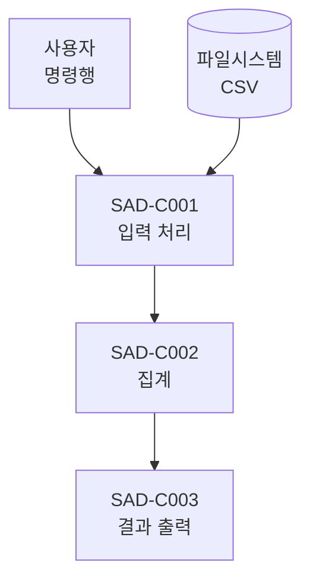

# SAD: CSV 요약 CLI

## 개요
CSV 파일 하나를 읽어 지정 열의 합계를 표준출력에 내는 단일 프로세스 CLI 도구의 구조를 정의한다.
모듈 내부 알고리즘과 함수 시그니처는 이 문서가 아니라 `SDD.md` 에서 다룬다.
- 상태: 승인
- 범위: `csvsum` CLI 실행 파일 하나. 네트워크·DB 의존 없음.

## 이해관계자와 관심사

```
[SAD-S001]
CLI 사용자 (역할: 사용자)
- 관심사: [SAD-K001]
```

```
[SAD-S002]
CLI 개발자 (역할: 개발자/유지보수자)
- 관심사: [SAD-K002]
```

```
[SAD-K001]
오류 가시성 — 실패 시 원인을 종료코드와 표준오류만으로 구분할 수 있어야 한다.
```

```
[SAD-K002]
유지보수성 — 외부 의존성 없이 표준 라이브러리만으로 구성해 설치·검증 부담을 낮춘다.
```

## 뷰포인트

```
[SAD-V001]
이름: 구조 뷰포인트
대상 이해관계자: [SAD-S001], [SAD-S002]
대상 관심사: [SAD-K001], [SAD-K002]
언어/기법: mermaid flowchart, 컴포넌트-커넥터 다이어그램
출처: 자체 정의 (Perry & Wolf 요소 모델 참고)
```

뷰포인트 선정 근거: 이 시스템은 단일 프로세스 CLI로 컴포넌트 수가 적고 행태가 단순해,
구조 뷰포인트 하나로 [SAD-S001][SAD-S002]의 관심사([SAD-K001][SAD-K002])를 모두 커버한다.

## 뷰

### [SAD-W001] 구조 뷰 (대응: [SAD-V001])



#### 컴포넌트

[SAD-C001]
구현요건: [SRS-F001]
입력 처리. 명령행 인자와 CSV 파일을 읽어 정규화된 레코드 스트림으로 바꾼다.
- 책임: 인자 검증, 파일 열기, 인코딩 판별, 헤더 확인
- 비책임: 수치 합산 ([SAD-C002] 담당), 출력 서식 ([SAD-C003] 담당)

[SAD-C002]
구현요건: [SRS-F002]
집계. 레코드 스트림에서 지정 열을 수치로 변환해 누적한다.
- 책임: 수치 변환, 합계 누적, 변환 실패 지점 식별
- 비책임: 파일 입출력 ([SAD-C001] 담당)

[SAD-C003]
구현요건: [SRS-F003]
결과 출력. 합계를 표준출력에, 오류를 표준오류에 쓴다.
- 책임: 출력 서식, 스트림 선택
- 비책임: 종료코드 결정 ([SAD-I001] 계약에 따름)

#### 외부 인터페이스

[SAD-I001]
구현요건: [SRS-F001], [SRS-N001]
명령행 경계 — `csvsum <파일경로> <열이름>`
- 입력: 인자 2개. 부족하거나 초과하면 사용법을 표준오류에 출력
- 출력: 표준출력에 합계 한 줄
- 실패 시 동작: 파일 없음 또는 열 없음이면 종료코드 1, 수치 변환 실패면 해당 행 번호를
  표준오류에 출력하고 종료코드 2. 부분 합산 결과는 출력하지 않는다.

[SAD-I002]
구현요건: [SRS-F001]
파일시스템 경계 — UTF-8 인코딩 CSV 읽기 전용 접근
- 입력: 파일 경로 문자열
- 실패 시 동작: 경로 없음·권한 없음·디코딩 실패를 모두 종료코드 1로 통일한다.
  쓰기는 하지 않으므로 롤백 대상이 없다.

#### 품질속성

[SAD-Q001]
구현요건: [SRS-N001]
오류 가시성 — 실패 원인을 호출자가 종료코드만으로 구분할 수 있다.
- 구조적 수단: 종료코드를 1(입력 문제)과 2(데이터 문제)로 분리하고,
  행 번호를 표준오류에 함께 출력한다.
- 확인 방법: 잘못된 경로와 잘못된 셀 각각으로 실행해 종료코드 1, 2 를 확인한다.

## 뷰 간 일관성
해당 없음(뷰 1개)

## 아키텍처 근거

[SAD-R001]
구현요건: [SRS-N001]
외부 라이브러리를 쓰지 않고 표준 라이브러리만으로 구성한다.
- 참조: ADR-001
- 영향 범위: [SAD-C001], [SAD-C002]

## 추적성

| SRS 요구사항 | SAD 항목 |
|---|---|
| [SRS-F001] | [SAD-C001], [SAD-I001], [SAD-I002] |
| [SRS-F002] | [SAD-C002] |
| [SRS-F003] | [SAD-C003] |
| [SRS-N001] | [SAD-I001], [SAD-Q001] |

| 이해관계자/관심사 | 커버 뷰포인트 |
|---|---|
| [SAD-S001] | [SAD-V001] |
| [SAD-S002] | [SAD-V001] |
| [SAD-K001] | [SAD-V001] |
| [SAD-K002] | [SAD-V001] |

## 미반영 목록
없음
