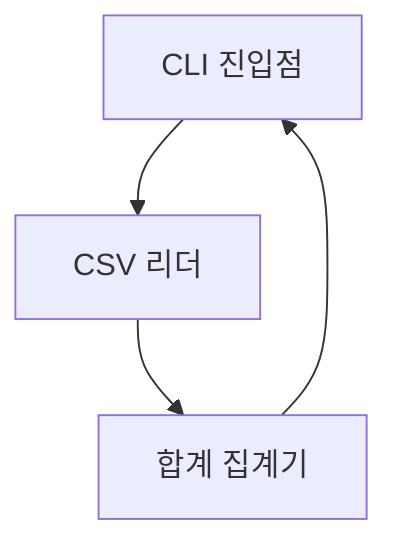

# SDD: CSV 요약 CLI

## 개요
SRS의 요구사항을 구현 가능한 설계 엔티티로 분해한다.

## 구조
CLI 진입점이 인자를 파싱해 리더와 집계기를 순서대로 호출한다.

## 상세 설계

[SDD-M001]
CSV 리더. 파일 경로를 받아 헤더와 데이터 행을 파싱해 딕셔너리 목록으로 반환한다.
파일이 없으면 FileNotFoundError 를 발생시킨다.
구현요건: [SRS-F001], [SRS-N001]

[SDD-M002]
합계 집계기. 파싱된 행 목록과 컬럼명을 받아 해당 컬럼의 숫자 합계를 반환한다.
구현요건: [SRS-F002]

[SDD-I001]
CLI 인터페이스. `summarize <파일경로> <컬럼명>` 인자를 받아 합계를 표준 출력에
한 줄로 출력하고, 오류 시 메시지 출력 후 종료 코드 1을 반환한다.
구현요건: [SRS-F002], [SRS-N001]

## ADR
이 설계에서 되돌리기 비용이 큰 결정은 없어 ADR을 작성하지 않았다.

## 미설계 목록
없음. SRS의 모든 요구사항이 위 설계 항목으로 커버된다.
